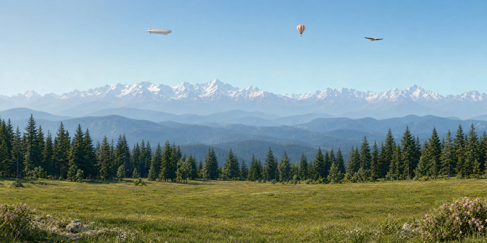

# Горы — ассеты Native Clouds

Подготовлено для gvedashvilirevaz9-stack/native-clouds-bazaar-test, 13 ноября 2026.

## Быстрый просмотр

- [Мастер PNG, 2880 × 1440](master.png)
- [Отдельные объекты](previews/objects.jpg)
- [Планы ландшафта](previews/layers.jpg)
- [Предварительный цикл орла](previews/eagle-motion.gif)
- [Манифест сцены](scene.json), [эталон с исходными вырезками](scene-reference.json)
- [Паспорт и измерения](scene-passport.json), [отчёт генерации](REPORT.md), [исходное задание](SOURCE-PLAN.md)

## Состав

Вся новая сцена находится в public/livebg/assets/scene-mountains/.
Мастер сохранён в исходном PNG без изменений. Остальные 19 ассетов преобразованы из PNG в WebP quality 88. Превью PNG также преобразованы в WebP.
Размеры и альфа-канал сохранены; пять кадров орла имеют одинаковый холст и точку привязки.
Новые облака лежат в clouds/ внутри этой папки и не заменяют старые облака портала.

| Файлы | Назначение |
|---|---|
| master.png | исходный полный мастер, 2880 × 1440 (2:1, не 4K) |
| background_clean.webp | фон без трёх летящих объектов |
| sky.webp, mountains.webp, foothills.webp, forest.webp, meadow.webp | пять планов на общем холсте 2880 × 1440 |
| airship.webp, balloon.webp | детализированные отдельные объекты |
| eagle_1.webp … eagle_5.webp | пять поз орла, каждый холст 1120 × 1120 |
| airship_master.webp, balloon_master.webp, eagle_master.webp | маленькие исходные вырезки для эталонного сравнения |
| clouds/cloud1.webp … clouds/cloud3.webp | три облака с прозрачностью |

## Подключение

scene.json использует assetBase: "/livebg/assets/scene-mountains/".
Пути src, url, frames, sprites задаются относительно этой базы. При переносе папки базу можно заменить на URL расположения самого JSON.
Планы не обрезать и не масштабировать отдельно. Порядок, координаты, размеры и anchor указаны в манифесте.
x/y — позиция точки привязки на общем холсте; width и size — ширина и высота спрайта в долях холста.
Для орла обязательно учитывать custom anchor, общую рамку и frameSequence: [0,1,2,1,0,3,4,3].

Это загрузка ассетов, а не изменение движка. До подключения необходимо адаптировать принимающий renderer к sky.src, общему холсту, явной ширине, anchor и последовательности кадров. Совместимость всего манифеста с текущим livebg.js автоматически не заявляется.
Для первого параллакса используйте ±20 px с запасом по краям 4%. Дополнительные облака, диск солнца и осадки в эталоне выключены.
Живые погода, время, движение и MCP не включаются этим набором.

## Проверки и происхождение

Исходный архив: Native-Clouds-Mountains-20261113.zip.
SHA-256: 350fcb8638d7005581b7111d054ce8b879b3a4be5ec8064f73e5891be1f1406b.

qa/webp-conversion.json проверяет размеры и точное сохранение альфа-канала после WebP.
qa/metrics.json и изображения сравнения относятся к исходной PNG/lossless-сборке до сжатия quality 88; это не измерения сжатой WebP-сцены.
MANIFEST.json содержит актуальные размеры и SHA-256 загруженных файлов.

Изображения ранее сгенерированы через разрешённый пользователем OpenAI API, фактическая модель — gpt-image-2, quality high. Детали и ограничения сохранены в REPORT.md.
В этой поставке нет ключей, серверных данных и исходного кода портала. Промпты приложены в prompts/ для воспроизводимости.

Важное отличие от старого public/livebg/ASSETS.md: порядок поз этого орла — планирование, полувзмах вверх, вверх, полувзмах вниз, вниз. Используйте последовательность из нового манифеста.
