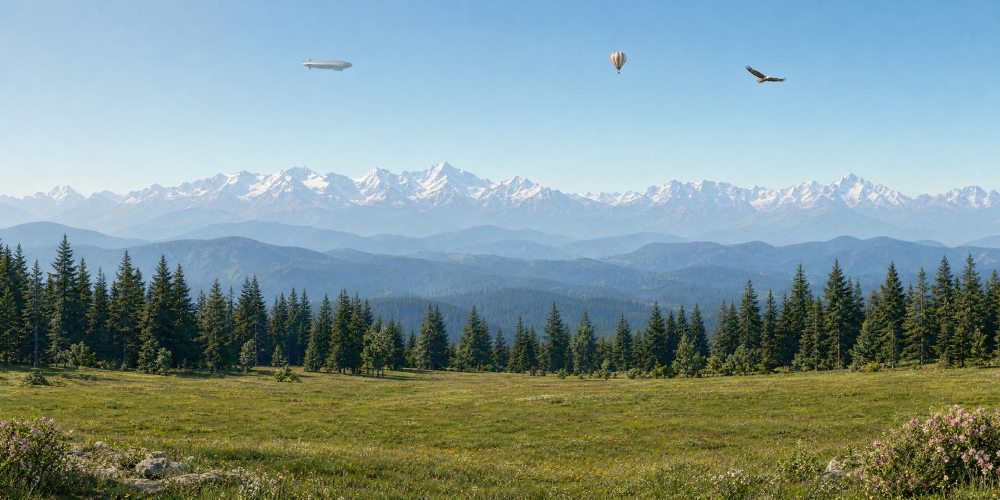
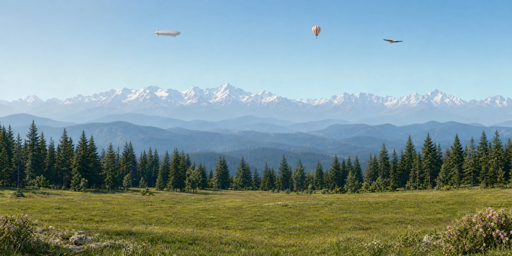
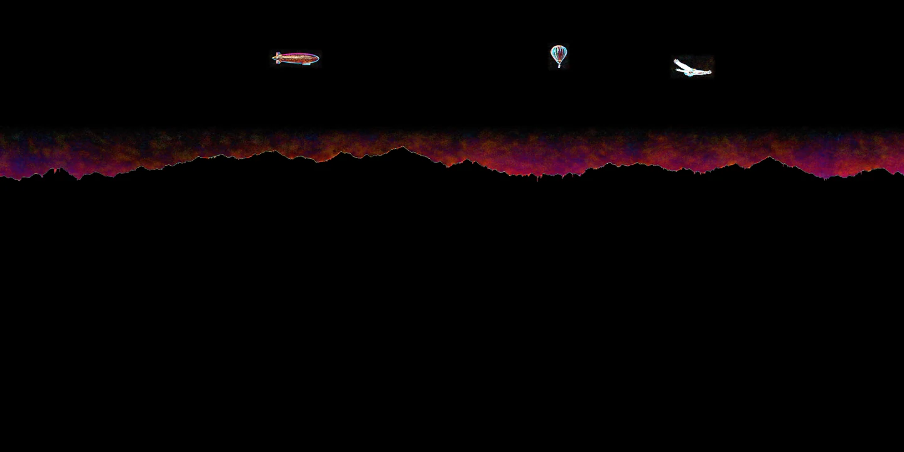

# Отчёт: сцена «Горы»

Дата: 13 ноября 2026. Набор для передачи Anthropic и экспериментов вне портала.

## Фактическая генерация

- Итоговая модель: gpt-image-2, качество high, OpenAI Images API через штатный imagegen CLI.
- В исходном задании указана gpt-image-2.6-sunburst. Первый пробный результат этой модели имел размер 1774 × 887 и слишком крупные объекты; он отклонён. Для явного размера использована gpt-image-2.
- Итоговый мастер и полноразмерные планы: 2880 × 1440, без апскейла мастера.
- Исходные детализированные генерации дирижабля и шара: 2048 × 1152; затем обрезка.
- Исходный лист пяти поз орла: 3072 × 2048; отдельные кадры приведены к общему холсту 1120 × 1120 с согласованной точкой тела.
- Исходный лист облаков: 3072 × 1024.
- Часть генераций с запросом прозрачности вернула RGB с нарисованной подложкой. Финальные файлы обработаны локально: выделение объектов, удаление подложки, мягкий альфа-край. В финальных PNG и WebP проверен реальный канал прозрачности.
- Видимые части планов взяты из общего мастера; скрытые продолжения получены отдельными генерациями и согласованы по цвету. Это сохраняет исходную сцену при нейтральном положении.

## Измерения и расположение

Координаты указаны на холсте 2880 × 1440. Bounding box включает небольшой запас по краям.

| Объект | Ожидалось по паспорту | В мастере, измерено | Бокс размещения в сборке |
|---|---:|---:|---|
| Дирижабль | длина 134,4 px | 153 px (+13,8%) | x=865, y=166, w=153, h=42 |
| Шар | высота 80 px | 72 px (−10%) | x=1754, y=144, w=53, h=72 |
| Орёл | размах 124,4 px | 125 px (+0,5%) | x=2143, y=184, w=125, h=59 |

Все три размера мастера укладываются в допуск ±25% исходного плана. Боксы размещения взяты из измерений, а не из размеров новых файлов. Полностью непрозрачный силуэт детализированного спрайта может занимать меньшую площадь внутри этого бокса. Совпадение силуэтов с точностью ±3% для повторно сгенерированных объектов не заявляется.

| Файл | Размер, px | Назначение |
|---|---|---|
| master, background_clean, sky | 2880 × 1440 | эталон, фон без объектов, небо |
| mountains, foothills, forest, meadow | 2880 × 1440 | планы с прозрачной верхней частью |
| airship | 1671 × 385 | детализированный дирижабль |
| balloon | 579 × 835 | детализированный шар |
| eagle_1 … eagle_5 | 1120 × 1120 каждый | пять согласованных холстов анимации |
| airship_master | 153 × 42 | исходная вырезка |
| balloon_master | 53 × 72 | исходная вырезка |
| eagle_master | 125 × 59 | исходная вырезка |
| cloud1 | 1012 × 1024 | отдельное облако |
| cloud2 | 1024 × 653 | отдельное облако |
| cloud3 | 914 × 1024 | отдельное облако |

В исходном архиве каждый ассет был сохранён как PNG и WebP lossless. Для GitHub мастер оставлен в PNG; остальные ассеты преобразованы в WebP quality 88. Измерения ниже относятся к исходной сборке до этого сжатия.

## Проверки

Проверки выполнены локальным композитингом изображений; портал не запускался и не менялся.

- SSIM ландшафта относительно очищенного фона: **0,9999986**.
- SSIM всей сцены с детализированными объектами и первым кадром орла относительно мастера: **0,9953781**.
- Среднее абсолютное расхождение RGB всей сцены: 0,43 из 255.
- Максимальное изменение очищенного фона вне участков удаления объектов: 0.
- У 17 PNG проверена настоящая альфа: есть и прозрачные, и видимые пиксели.
- Нижняя строка каждого ландшафтного плана непрозрачна.
- При пробных сдвигах −20 и +20 px с запасом 4% прозрачных дыр в сборке нет.

Высокий SSIM ландшафта обусловлен сохранением видимых пикселей мастера. Полный SSIM в основном оценивает большой фон и не доказывает идентичность небольших объектов. Сырые измерения — в qa/metrics.json.

## Ограничения для следующей итерации

- Контуры разделения планов приближённые. В скрытых продолжениях возможны следы гребней и деревьев около границ. Сильный параллакс потребует доработки масок и этих участков.
- Дирижабль и шар сохранены по общему дизайну, но повторная генерация изменила детали. Детализированный орёл получил светлую голову, в отличие от исходного образца. Для буквального статического сравнения использовать варианты с суффиксом _master.
- При генерации ASSETS.md, упомянутый в задании, не был предоставлен. При загрузке в репозиторий обнаружена его старая версия с другим порядком кадров; для этого набора использовать новый scene.json. Взяты пять поз: планирование, полувзмах вверх, вверх, полувзмах вниз, вниз. Предварительная последовательность: 0, 1, 2, 1, 0, 3, 4, 3. Это экспериментальный цикл, не видеосимуляция полёта.
- Физические высоты и расстояния в паспорте — художественное задание, не восстановленная и проверенная геометрия 3D-сцены.
- Реальный формат 2880 × 1440 — 2:1. Фраза в исходнике про 16:9 и около 6% запаса геометрически неточна; холст оставлен по явно указанным размерам.
- Живая погода, смена времени, движение и команды агента должны быть подключены в принимающем движке. Этот архив поставляет изображения и манифест.
- Размер мастера не 4K. Движок портала и веб-версия не изменены.

## Изображения для сравнения

Уменьшенные превью — 1440 × 720. Полный мастер лежит рядом с этим отчётом.

### Мастер

### Сборка подготовленных слоёв

### Абсолютная разница, усиление ×8

Чёрный цвет означает отсутствие различий. Отличия в основном сосредоточены на объектах и их краях.

